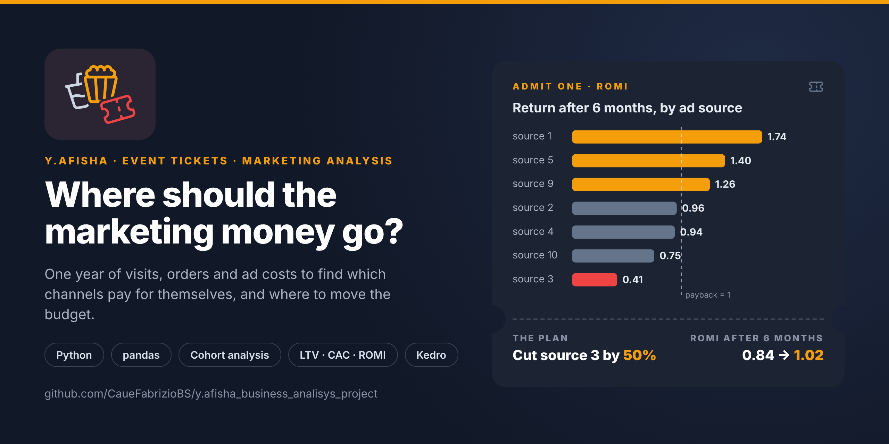
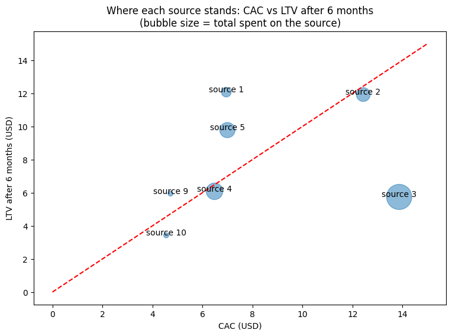

# Y.Afisha: where should the marketing money go?

[](https://nbviewer.org/github/CaueFabrizioBS/y.afisha_business_analisys_project/blob/main/notebooks/y_afisha_analysis.ipynb)
[](https://cauefabriziobs.github.io/y.afisha_business_analisys_project/)

Y.Afisha sells tickets for events. The marketing team spends money on several ad channels, and nobody is sure that every channel pays for itself.

This project uses one year of data (June 2017 to May 2018) to answer that question. It looks at how people use the site, when and how much they buy, and how much each ad channel costs compared with what its customers bring back. The analysis is done in a Jupyter notebook, and the same steps are also built as a Kedro pipeline.

## What I found

- **The marketing didn't pay for itself this year.** About 329,000 USD were spent and the customers brought back 252,000 (ROMI of 0.77).
- **Most of the problem is where the money goes.** Source 3 takes 43% of the budget and brings the most customers, but each one costs 13.9 USD and spends 5.7 in 6 months. Only 0.41 comes back for each dollar spent there, and it's the worst source in every way it was measured.
- **Some channels already pay back.** After 6 months, sources 1 (1.74), 5 (1.40) and 9 (1.26) bring more than they cost. Source 4 is just below 1, but its recent cohorts already pay back (1.15).
- **Most people buy once, on the first day.** 69% of the customers buy on the same day as the first visit, and 83% never buy again.
- **Desktop customers spend more, mostly because of a few big orders.** They bring 8.1 USD in 6 months against 6.3 on phones and tablets. The difference is statistically significant (Welch's t-test, p ≈ 0.01, confirmed by Mann-Whitney), but without the top 1% of customers it falls to 0.19 USD.



Each bubble is an ad channel, sized by how much was spent on it. Above the red line, the customers bring more than they cost in 6 months.

**Recommendation:** cut sources 3 and 10 by half (73,572 USD, 22% of the budget). Move 38,860 to sources 1 (+100%), 4 (+25%) and 9 (+50%), and keep 34,712 as a reserve released in quarterly steps. The number of customers stays about the same, and the 6-month ROMI goes from 0.84 to about 1.02 in the best case.

## What the notebook does

1. **Loading and preparing the data:** reads the files with the right types (86% less memory), fixes column names, checks missing values, duplicates and the period, and removes 2 broken sessions and 1 order outside the period.
2. **Product:** DAU, WAU and MAU, sticky factor, sessions per day, session length and retention by monthly cohort.
3. **Sales:** time to the first purchase, orders per customer, average purchase and LTV by cohort and by device.
4. **Marketing:** costs by source and over time, CAC by source and per month, ROMI by cohort and by source, two checks of the results (recent cohorts and last-visit attribution) and a budget plan.
5. **Hypothesis test:** do desktop customers spend more than touch customers? Levene's test, Welch's t-test (α = 0.05) and a robustness check with Mann-Whitney.
6. **Conclusion:** where to put the marketing money, and what to keep in mind.

## The Kedro pipeline

The notebook is where the analysis is explained. The Kedro pipeline runs the same steps as code that can be repeated with one command, and saves the final tables in `data/08_reporting`.

There are four pipelines, one for each step of the notebook:

| Pipeline | What it does |
|---|---|
| `data_processing` | Cleans the visits and the orders |
| `product` | DAU, WAU, MAU, sticky factor, session length and retention |
| `sales` | Buyers table, time to purchase, order cohorts and LTV |
| `marketing` | CAC and ROMI by source, ROMI by cohort and the hypothesis test |

The **See the pipeline** button above opens Kedro-Viz, a map of the whole pipeline where you can click each step to see its code and data.

## How to run it

```
pip install -r requirements.txt
kedro run
kedro viz run
```

`kedro run` runs all the steps and `kedro viz run` opens the pipeline map in the browser. On Windows with Anaconda, you can also double-click `run_pipeline.bat`, which does both.

To see the analysis, open `notebooks/y_afisha_analysis.ipynb` and run all the cells.

## Repository structure

```
y.afisha_business_analisys_project/
├── notebooks/
│   └── y_afisha_analysis.ipynb   # the analysis
├── data/
│   ├── 01_raw/                   # original files: visits, orders and costs
│   ├── 02_intermediate/          # clean data (made by Kedro)
│   ├── 03_primary/               # buyers and cohort tables (made by Kedro)
│   └── 08_reporting/             # final tables (made by Kedro)
├── conf/base/
│   ├── catalog.yml               # where each file is and how to read it
│   └── parameters.yml            # cutoff date and alpha of the test
├── src/y_afisha/pipelines/       # Kedro code, one folder per step
├── docs/                         # Kedro-Viz page shown by the button
├── images/                       # README images
├── run_pipeline.bat              # runs the pipeline on Windows
├── pyproject.toml                # tells Kedro this folder is a project
└── requirements.txt
```

## Tools

Python (pandas, NumPy, SciPy, matplotlib, seaborn), Jupyter, Kedro and Kedro-Viz.

---

Project developed as part of the TripleTen Data Analyst program.
